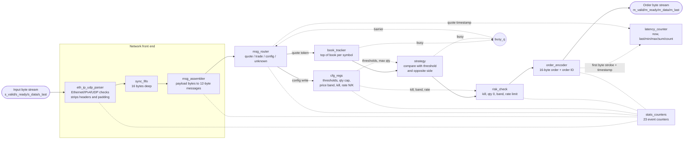
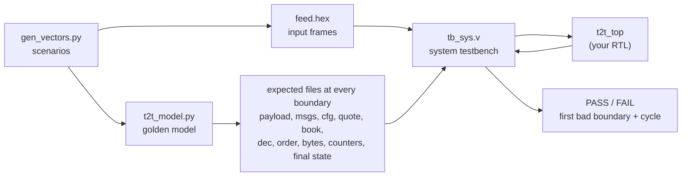

# Tick-to-Trade Engine in Verilog

A byte-stream **tick-to-trade pipeline** written in plain Verilog-2001 and verified in simulation against an independent Python golden model.
A market-data frame goes in on a byte stream; if the strategy and the risk checks agree, a 16-byte order comes out. The delay between the two is measured in clock cycles.

> **Scope in one sentence:** a learning-grade, simulation-verified model of the logic inside a low-latency trading FPGA: *parse the network frame, decode the market message, update a book, decide, risk-check, encode an order, and measure the latency*. It does **not** include Ethernet MAC/PHY, TCP, a real exchange protocol or any hardware measurement (see [Limitations](#10-limitations-and-honest-scope)).

**Status:** v1.0 RTL frozen after verification · 15 RTL files, about 3,000 lines · simulation only · FPGA results are in [section 9](#9-fpga-implementation-results-to-fill-in).

---

## Contents

1. [What problem does this solve?](#1-what-problem-does-this-solve)
2. [Background for newcomers](#2-background-for-newcomers-markets-and-networking-in-5-minutes)
3. [Architecture](#3-architecture)
4. [Data formats](#4-data-formats-byte-by-byte)
5. [Module guide](#5-module-guide)
6. [Latency: what is measured and how](#6-latency-what-is-measured-and-how)
7. [Verification](#7-verification)
8. [Results](#8-results)
9. [FPGA implementation results](#9-fpga-implementation-results-to-fill-in)
10. [Limitations and honest scope](#10-limitations-and-honest-scope)
11. [How to run everything](#11-how-to-run-everything)
12. [Repository layout and reading order](#12-repository-layout-and-suggested-reading-order)
13. [FAQ](#13-faq)

---

## 1. What problem does this solve?

In electronic trading, an **exchange** publishes a continuous stream of **quotes** (the best prices people will buy or sell at). A trading firm wants to react to a quote *faster than competitors*: if a quote shows something worth acting on, send an **order** before the opportunity disappears. The time from "the market data arrives" to "our order leaves" is called **tick-to-trade latency**. Firms compete on it in nanoseconds, which is why the logic is built in hardware (FPGAs) instead of software: the work happens as the bytes stream through, with a fixed, predictable delay.

This project builds that whole path in Verilog:

```
 bytes of a network frame ──►  parse ► decode ► book ► strategy ► risk ► order encode ──► 16 bytes of order
                               └────────────────  7 clock cycles when idle  ──────────────┘
```

Everything is **cycle-accurate and deterministic**: the same input always gives the same output in the same number of cycles.

### What you will understand after reading this

* What each stage does and exactly what it passes to the next stage.
* The byte layout of the input frame, the market messages, the config messages and the order.
* How latency is defined and measured, and why the number is 7 cycles.
* How the design was verified, how good that verification is, and what it does **not** prove.

---

## 2. Background for newcomers (markets and networking in 5 minutes)

### Market terms used in this project

| Term | Meaning here |
|---|---|
| **Symbol** | An instrument, identified by a number 0 to 7 in this design (8 symbols). |
| **Bid** | The best price someone will *buy* at. Market side `0`. |
| **Ask** | The best price someone will *sell* at. Market side `1`. |
| **Quote** | A message saying "for symbol S, the best bid (or ask) is now price P for quantity Q". |
| **Trade** | A message saying a trade happened. This design counts trades but does not act on them. |
| **Top of book** | The current best bid and best ask per symbol. This design keeps only this level (no depth). |
| **Order** | What we send out: buy or sell, symbol, price, quantity. |
| **Buy / sell side of an order** | Order side `0` = buy, order side `1` = sell. (Different from the market side above.) |
| **Price / quantity** | Unsigned 32-bit integers. Prices are in "ticks"; no decimals. |
| **Kill switch** | A config flag that blocks all orders immediately. |
| **Risk check** | A last gate before an order goes out: kill switch, zero quantity, price band, rate limit. |

### Networking terms used in this project

| Term | Meaning here |
|---|---|
| **Frame** | One Ethernet packet as a sequence of bytes. |
| **Ethernet II / IPv4 / UDP** | Three nested headers at the start of the frame. The parser reads them at **fixed byte positions** (this works because the header formats here are fixed-size). |
| **Big-endian** | The most significant byte comes first. `0x0800` is sent as bytes `08 00`. |
| **UDP destination port** | A 16-bit number telling which application a packet is for. The parser only accepts frames for the configured port. |
| **Payload** | The bytes after the UDP header: here, a small packet header followed by market messages. |
| **AXI4-Stream style byte interface** | A `valid`/`ready`/`data`/`last` handshake (explained below). |

### The handshake used between every pair of modules

Every module connects to the next with four wires:

| Wire | Direction | Meaning |
|---|---|---|
| `valid` | sender → receiver | "I am presenting a byte (or token) now." |
| `ready` | receiver → sender | "I can accept it now." |
| `data` | sender → receiver | The byte (or the fields of a token). |
| `last` | sender → receiver | "This is the final byte of the frame/packet." (byte interfaces only) |

A **transfer** happens on a clock edge only when `valid` and `ready` are both 1. Two rules make the whole system safe:

1. A sender that is *not accepted* must keep `valid` high and the data **unchanged** until a transfer happens.
2. A receiver may stall (`ready = 0`) at any time. The stall travels backwards through the pipeline.

```
clk     _|‾|_|‾|_|‾|_|‾|_|‾|_|‾|_
valid   ____/‾‾‾‾‾‾‾‾‾‾‾‾‾‾‾‾\____
ready   ______/‾‾‾‾‾‾\____________      transfer happens where both are high
data    ----< A  stays A  >-------      A is held steady until accepted
```

---

## 3. Architecture

### 3.1 Block diagram



The same picture as text, for viewers that do not render diagrams:

```
 bytes in                                                                             bytes out
 ───────► eth_ip_udp_parser ─► sync_fifo ─► msg_assembler ─► msg_router ─► book_tracker ─► strategy ─► risk_check ─► order_encoder ───►
              │ events            (16)          │ events       │   │                │ busy      │ busy      │ events        │ events
              │                                 │              │   └► cfg_regs ─────┴───────────┴───────────┘               │ first-byte strobe
              ▼                                 ▼              ▼       (thresholds, qty cap, band, kill, rate N/K)         ▼
          stats_counters (23 counters)  ◄───────┴──────────────┴─────────────────────────────────────────────────────  latency_counter
                                  busy_q = book_busy | strategy_busy  ──► msg_router (config barrier)
```

### 3.2 Two kinds of "tokens" on the internal wires

After the router the data is no longer bytes. Each stage hands the next one a **token** (a bundle of fields moved in one transfer):

| Token | Between | Fields |
|---|---|---|
| `BYTE` | input, parser, FIFO, assembler, and the output | `data[7:0]`, `last` |
| `MSG` | assembler → router | `type`, `sym[7:0]`, `side[7:0]`, `px[31:0]`, `qty[31:0]` |
| `QUOTE` | router → book | `sym[2:0]`, `side`, `px`, `qty`, `ts` (timestamp) |
| `BOOK` | book → strategy | the quote plus the **opposite side's stored price and qty**, `ts` |
| `DEC` | strategy → risk | `fire`, `sym`, `side` (order side), `px`, `qty` (clamped), `ts` |
| `ORD` | risk → encoder | `sym`, `side`, `px`, `qty`, `ts` (only for orders that passed) |

Every quote produces exactly one `BOOK` token and one `DEC` token; only a passed order produces an `ORD` token. That one-token-per-quote rule is what makes the rate-limit window and the counters easy to reason about.

### 3.3 In-band configuration and the barrier

There is no CPU and no register bus. The design is configured **by sending config messages in the same market-data stream** (message type 3). The router sends them to `cfg_regs`.

Problem: a config message that arrives right behind a quote must not change the rules *for a quote that came before it*, and must apply to every quote *after* it. The router therefore holds a config write until `busy_q = book_busy | strategy_busy` is low, meaning the quotes ahead of it have left the book and strategy stages. This is the **config barrier**. The tests cover it directly (a config message directly behind a firing quote, in the same packet).

### 3.4 Clock, reset and timing style

* One clock `clk`, one **synchronous active-high** reset `rst` for all modules.
* Registered outputs between stages: each stage adds a fixed, small number of cycles.
* `ready` does not depend on `valid` in the token stages (it is `!out_valid || out_ready`), which avoids long combinational chains and combinational loops.
* No vendor IP, no `$clog2`, no SystemVerilog: Verilog-2001 only.

---

## 4. Data formats, byte by byte

### 4.1 Input frame (Ethernet II + IPv4 + UDP + payload)

Byte positions are counted from 0 at the first byte of the frame. The parser only looks at the fields in **bold**.

| Bytes | Field | Expected value / handling |
|---|---|---|
| 0-5 | Destination MAC | ignored |
| 6-11 | Source MAC | ignored |
| **12-13** | EtherType | must be `0x0800` (IPv4), else *drop: ethertype* |
| **14** | IPv4 version + header length | must be `0x45` (IPv4, 20-byte header), else *drop: ipver* |
| 15 | DSCP/ECN | ignored |
| **16-17** | IPv4 total length | must equal `UDP length + 20`, else *drop: len* |
| 18-22 | ID, flags, fragment, TTL | ignored |
| **23** | IP protocol | must be `17` (UDP), else *drop: proto* |
| 24-25 | IP header checksum | **not checked** |
| 26-33 | Source and destination IP | ignored |
| 34-35 | UDP source port | ignored |
| **36-37** | UDP destination port | must equal `cfg_dport` (input pin), else *drop: port* |
| **38-39** | UDP length | must be at least 9 (header 8 + at least 1 payload byte), else *drop: len* |
| 40-41 | UDP checksum | **not checked** |
| 42 … | **Payload** | exactly `UDP length - 8` bytes are forwarded; `last` is set on the final one |
| after | Padding / Ethernet FCS | discarded |

A frame that ends early (a "runt") is counted as *drop: len*, including the case where the frame ends on the very byte where a header check fails.

### 4.2 Payload: a small packet header plus up to 8 messages

```
 byte:   0     1     2     3     4     5     6     7     8 ........ 19    20 ....... 31   ...
       ┌───────────────────────┬───────────────┬───────────────┬─────────────┬─────────────┐
       │ sequence number (4 B) │ count n (2 B) │ reserved (2 B)│  message 0  │  message 1  │ ...
       └───────────────────────┴───────────────┴───────────────┴─────────────┴─────────────┘
```

* Valid packet length is exactly `8 + 12 * n` bytes with `1 <= n <= 8` (maximum 104 bytes).
* `n` outside 1 to 8 → counted as *bad count*; a length that does not match `n` → counted as *bad length*.
* Messages that arrived completely are still delivered even if the packet is later found to be the wrong length.
* The sequence number and reserved bytes are carried but not used.

### 4.3 Market-data / config message (12 bytes, big-endian)

| Byte | Field | Notes |
|---|---|---|
| 0 | `type` | `1` quote · `2` trade · `3` config · anything else = unknown |
| 1 | `sym` | symbol 0-7 (for config: the **register index**) |
| 2 | `side` | `0` bid, `1` ask (must be 0 or 1 for quote/trade) |
| 3 | reserved | ignored |
| 4-7 | `px` | price (for config: the **value**) |
| 8-11 | `qty` | quantity |

A quote or trade with `sym > 7` or `side > 1` is counted as *bad field* and dropped.

### 4.4 Configuration registers (written by type-3 messages: `sym` = index, `px` = value)

| Index | Register | Reset value | Meaning |
|---|---|---|---|
| `0x00-0x07` | `BUY_THR[0..7]` | `0` | Buy when an ask is **below** this price (reset 0 = never buys) |
| `0x08-0x0F` | `SELL_THR[0..7]` | `0xFFFFFFFF` | Sell when a bid is **above** this price (reset = never sells) |
| `0x10` | `MAX_QTY` | `0xFFFFFFFF` | Order quantity is capped to this |
| `0x11` | `PX_LO` | `0` | Lowest allowed order price (inclusive) |
| `0x12` | `PX_HI` | `0xFFFFFFFF` | Highest allowed order price (inclusive) |
| `0x13` | `KILL` | `0` | Bit 0 only; `1` blocks every order |
| `0x14` | `RATE_N` | `0` | Max orders per window (see 5.9); writing it **clears the rate window** |
| `0x15` | `RATE_K` | `0` | Window length in quotes; `0` turns the limiter off; writing it **clears the rate window** |

Any other index is ignored and counted as *cfg bad*. All 22 registers can be read back through the debug ports `dbg_cfg_idx` / `dbg_cfg_val`.

### 4.5 Order message out (16 bytes, big-endian)

| Byte | Field | Notes |
|---|---|---|
| 0 | type | always `0x10` |
| 1 | `sym` | 0-7 |
| 2 | side | `0` buy, `1` sell |
| 3 | reserved | `0` |
| 4-7 | `px` | the quote's price |
| 8-11 | `qty` | `min(quote qty, MAX_QTY)` |
| 12-15 | order ID | starts at 1 after reset, +1 per order |

`last` is high on byte 15.

### 4.6 One complete worked example

Setup (earlier config messages): `BUY_THR[3] = 105`, everything else at defaults, and a bid for symbol 3 at price 98, quantity 5 is already in the book.

A frame arrives whose payload contains one quote:

```
quote message:  01 03 01 00  00 00 00 64  00 00 00 0A
                │  │  │  │   └─ px = 100   └─ qty = 10
                │  │  │  └ reserved
                │  │  └ side 1 = ask
                │  └ symbol 3
                └ type 1 = quote
```

1. The book stores ask 100 / 10 for symbol 3 and passes along the stored **opposite side**: bid 98 / 5.
2. Strategy (ask quote → possible **buy**): quantity > 0 ✔, price `100 < BUY_THR[3] = 105` ✔, opposite side exists ✔, `bid 98 < ask 100` ✔ → **fire**.
3. Risk: kill off ✔, quantity not zero ✔, price inside the band ✔, rate limiter off ✔ → **pass**.
4. The encoder emits 16 bytes: `10 03 00 00  00 00 00 64  00 00 00 0A  00 00 00 01`  
   (type `0x10`, symbol 3, **buy**, price 100, quantity 10, order ID 1).

---

## 5. Module guide

This section is the complete behavioural description of each module: what it takes in, what it produces and the corner cases that matter. The RTL is in `rtl/`.

### 5.1 `eth_ip_udp_parser`

* **In:** raw frame bytes. **Out:** only the UDP payload bytes, with `last` on the final payload byte.
* Checks the fields in section 4.1 in order as the bytes stream by. Every frame produces exactly one event: *good* or one of five drop reasons.
* Header checks finish before the payload starts at byte 42, so a bad frame never leaks payload bytes downstream.
* Output is a one-byte register with the same handshake rule as above.
* Not handled on purpose: VLAN tags, IP options/fragments, checksums, FCS.

### 5.2 `sync_fifo` (generic byte FIFO)

* First-word-fall-through FIFO, depth `2^ADDR_W` (default `ADDR_W = 4` → 16 bytes, parameter `FIFO_ADDR_W` on the top).
* Absorbs short stalls between the parser and the assembler. Has a `level` output.

### 5.3 `msg_assembler`

* Collects payload bytes into 12-byte messages after the 8-byte packet header, and checks packet length and count (section 4.2).
* Emits one `MSG` token per complete message. Events: *packet good*, *bad count*, *bad length*.

### 5.4 `msg_router`

* Looks at `type`: quote → `QUOTE` token to the book (with a timestamp from the free-running `now` counter); trade → counted only; config → `cfg_regs` write (held behind the barrier); anything else → *unknown*.
* Validates `sym <= 7` and `side <= 1` for quotes and trades (*bad field* otherwise).

### 5.5 `cfg_regs`

* Holds the 22 registers of section 4.4, drives them to the strategy and risk stages, and provides the read-back port.
* Pulses `rate_clr` for one cycle when RATE_N or RATE_K is written.

### 5.6 `book_tracker`

* One bid (price, quantity) and one ask (price, quantity) per symbol: 8 symbols, top of book only.
* A quote replaces the stored value on its side. The output `BOOK` token carries the new quote **and the old stored value of the opposite side** (price and quantity; zero quantity means "nothing there").
* Debug read ports (`dbg_book_sym` and the four `dbg_*` outputs) show the stored book.

### 5.7 `strategy`

Pure comparison logic, one registered output. All comparisons are strict and unsigned:

| Quote side | May trigger | Fires when ALL of these hold |
|---|---|---|
| **Ask** (market side 1) | **Buy** (order side 0) | `qty > 0` and `px < BUY_THR[sym]` and opposite bid qty > 0 and `bid px < ask px` |
| **Bid** (market side 0) | **Sell** (order side 1) | `qty > 0` and `px > SELL_THR[sym]` and opposite ask qty > 0 and `ask px > bid px` |

The order quantity is `min(qty, MAX_QTY)`. The "opposite side must exist and not be crossed" condition is a sanity gate: never act on a one-sided or crossed book.

### 5.8 `risk_check`

Applied in this fixed order to every `DEC` token that has `fire = 1`; the **first** failing check wins and is counted:

1. **Kill switch** on → reject (*rej_kill*)
2. **Quantity = 0** → reject (*rej_qty0*)
3. **Price outside `[PX_LO, PX_HI]`** → reject (*rej_band*)
4. **Rate limit** exceeded → reject (*rej_rate*)
5. Otherwise **pass** and forward the `ORD` token.

A token with `fire = 0` is counted as *nofire* and goes nowhere.

### 5.9 Rate limiter (inside `risk_check`)

A **tumbling window**, counted in quotes rather than in time:

* The window is `RATE_K` quote tokens long. Every `DEC` token counts toward it (even no-fire ones).
* At most `RATE_N` orders may pass in one window; the next fire in the same window is rejected.
* After the `K`-th token the window closes and both counters restart at zero.
* `RATE_K = 0` disables the limiter. Writing `RATE_N` or `RATE_K` restarts the window.

Example, `N = 2`, `K = 5`, eight consecutive firing quotes: pass, pass, reject, reject, reject (window ends), pass, pass, reject.

### 5.10 `order_encoder`

* Accepts an `ORD` token, assigns the next order ID (starts at 1) and sends 16 bytes (section 4.5).
* Pulses `first_byte_xfer` and `first_byte_ts` when byte 0 is accepted. This is the measurement point for latency.

### 5.11 `stats_counters`

23 free-running 32-bit event counters (they wrap around at 2^32), packed into one 736-bit bus `cnt_flat` (counter *k* is `cnt_flat[32*k +: 32]`):

| # | Counter | Counts |
|---|---|---|
| 0 | `par_good` | frames accepted by the parser |
| 1-5 | `par_drop_ethertype / ipver / proto / port / len` | frames dropped, by reason |
| 6 | `asm_pkt_good` | payloads with a valid header and length |
| 7 | `asm_pkt_bad_count` | message count outside 1 to 8 |
| 8 | `asm_pkt_bad_len` | length does not match the count |
| 9 | `rt_quote` | quotes routed to the book |
| 10 | `rt_trade` | trade messages |
| 11 | `rt_config` | config messages |
| 12 | `rt_unknown` | unknown message types |
| 13 | `rt_badfield` | bad `sym`/`side` on a quote or trade |
| 14 | `cfg_write` | accepted config writes |
| 15 | `cfg_bad` | config writes with an invalid index |
| 16 | `risk_nofire` | decisions that did not fire |
| 17 | `risk_pass` | orders passed |
| 18-21 | `risk_rej_kill / qty0 / band / rate` | orders rejected, by reason |
| 22 | `enc_orders_sent` | orders fully serialised |

### 5.12 `latency_counter`

* A free-running 32-bit `now` counter (the timestamp source) and the statistics `lat_last`, `lat_min`, `lat_max`, `lat_sum` (64-bit), `lat_count`.
* On each order's first byte it records `now - quote_timestamp`: the **on-chip decision latency** (section 6).

### 5.13 Standalone helper modules (not in `t2t_top` for v1)

| Module | Purpose |
|---|---|
| `axis_register` | Two-entry skid buffer: full throughput **and** a registered `ready`. Not inserted in v1 because the `ready` chain is short; one could be added between any two stages if timing needs it. |
| `axis_slice` | One-entry register slice (`ready = !valid || ready_out`). Used as a building block. |
| `replay_rom` | Replays a recorded byte stream from a ROM (`$readmemh`) for demos and simulation. Simulation-oriented; not part of the synthesised top. |

### 5.14 `t2t_top`

Instantiates and wires everything: `u_parser`, `u_payload_fifo`, `u_msg_assembler`, `u_msg_router`, `u_cfg_regs`, `u_book_tracker`, `u_strategy`, `u_risk_check`, `u_order_encoder`, `u_stats_counters`, `u_latency_counter`, and forms `busy_q = book_busy | strategy_busy`.

**Top-level ports:** `clk`, `rst`, `cfg_dport[15:0]`, the input byte stream (`s_*`), the order byte stream (`m_*`), `cnt_flat[735:0]`, `lat_*` statistics, and the debug read ports (`dbg_book_sym`, `dbg_bid/ask_px/qty`, `dbg_cfg_idx`, `dbg_cfg_val`).

---

## 6. Latency: what is measured and how

Two definitions are used. Both are in **clock cycles**.

| Name | From | To | Idle value |
|---|---|---|---|
| **Official tick-to-order latency** | the clock edge where the **last byte of the triggering message** is accepted at the input | the clock edge where the **first byte of the order** is accepted at the output | **7 cycles** |
| **On-chip decision latency** | the quote token leaving the router (timestamped) | first byte of the order | **4 cycles** |

The 4-cycle part is consistent with one register per stage (book, strategy, risk, encoder). The remaining 3 cycles are the front end (parser output register, FIFO, assembler).

* The testbench measures both independently by watching the wires, and **checks the design's own `latency_counter` against the testbench measurement** (they must agree exactly).
* **7 is the unloaded figure.** With downstream stalls the order waits for `ready`: in the stress runs the average was 14 cycles and the maximum 49 to 105 cycles (see section 8). Quote the 7 only together with the words "idle pipeline".
* To convert to time: `latency_ns = cycles / f_clk_MHz × 1000`. The value of `f_clk` comes from the FPGA run (section 9), not from this repository.

---

## 7. Verification

### 7.1 Principle: an independent model

The golden model `t2t_model.py` was written **from the written design specification only, not from the RTL**. It produces the *expected data at every boundary* of the pipeline. A mismatch is localised immediately: the first failing boundary is the guilty stage.



### 7.2 What the system testbench checks (`tb_sys.v`)

| Check | What it means |
|---|---|
| **Per-boundary scoreboards** | parser→FIFO, FIFO→assembler, assembler→router, router→cfg, router→book, book→strategy, strategy→risk, risk→encoder, output bytes: every transferred token compared with the model, in order. |
| **Hold-while-stalled monitors** | On 8 internal interfaces: once `valid` is high and not accepted, `valid` and data must not change. |
| **All 23 counters** | Compared with the model's counts at the end of the run. |
| **Latency** | Official and decision latency measured by the testbench; the design's `latency_counter` must match exactly. |
| **Final-state read-back** | The book (8 symbols) and all 22 config registers are read through the debug ports and compared with the model. |
| **Reset** | Optional mid-run reset; checks that all state returns to its reset values, then reruns the scenario. |
| **Throughput** | If the input has no gaps and the output never stalls, the input must never be stalled. |
| **Randomised pressure** | Input gaps (`GAP %`), output stalls (`STALL %`), long output stall bursts, and a small FIFO (`-DFAW=1`, 2 entries) to force the FIFO-full path. |

### 7.3 Scenarios

| Scenario | Purpose |
|---|---|
| `ref` | One clean flow: configure, build the book, fire. Also the reference for the 7/4-cycle latency. |
| `story` | Directed story: every drop reason, kill on/off, price band, rate window, bad counts/lengths, runt frames. |
| `edge` | Boundary sweeps: rate limiter for every N in 0-4 and K in 0-6 (both sides), price-band edges (price equal to low/high, low > high), `MAX_QTY` clip edges, the config barrier, equal/crossed prices, extreme values (0 and `0xFFFFFFFF`), 40 back-to-back minimum frames. |
| `gaps` | Frames that fail on their **last byte**, every UDP length from 0 to 13, payload sizes 1 to 21 with valid and invalid counts, RATE_N / RATE_K clearing the window. |
| `defaults` | Only BUY thresholds configured: kill, max qty, band and rate limiter run on their **reset values**. |
| `random` | Seeded random traffic: all message types, bad fields, malformed frames, config storms, truncations. |
| `nofire` | Quotes and trades only, with no config: nothing may fire and the input must never stall. |

### 7.4 Standalone tests

| Test | What it checks |
|---|---|
| `tb_unit.v` for `axis_slice` and `axis_register` | Data/last order, no loss or duplication, hold-while-stalled, full throughput (1 beat/cycle), reset behaviour; 8 input/output pressure mixes × 3 seeds each. |
| `tb_rom.v` for `replay_rom` | Output bytes and `last`, hold under stall, rising-edge `start` only (held-high start gives exactly one pass), ignored restarts while running, `done`, loop mode, reset mid-pass; ROM sizes 1, 2, 16, 37, 100. |

### 7.5 Mutation testing (how good are the tests?)

`mutate.py` plants one deliberate bug at a time in the RTL (swap `<` and `<=`, `&&` and `||`, `==` and `!=`, flip `1'b0`/`1'b1`, change `+ 1`) and runs the test list. A mutant that still passes is either harmless or a **hole in the tests**. Every survivor was reviewed; the harmless ones are listed in `equivalent.txt` with the reason (dead signals, don't-care reset values of registers that are always loaded before use, loop bounds with identical behaviour, equal-value comparisons).

Mutation testing found real holes in the first version of the tests (debug-port read-back, RATE_N window clear, reset defaults, last-byte header failures, FIFO-full). Those tests were added and the campaign was repeated; see the results.

### 7.6 Other checks

* **Port check:** every module's port names, directions and widths compared with the interface specification embedded in `port_check.py`: 15 / 15 match.
* **Lint / synthesis sanity:** Verilator lint and a Yosys generic synthesis of `t2t_top` complete without errors and without inferred latches.

### 7.7 What verification does *not* prove

* The model and the RTL were both written from the same design specification. A wrong *requirement* would pass every test, so the strategy and risk rules in section 5 should be read as the intended behaviour and judged on their own merits.
* Simulation says nothing about timing closure, clock frequency, resource use or real-board behaviour.
* The input is synthetic. It is not a recording of a real exchange feed.

---

## 8. Results

> Fill the "date / commit" line when you tag the release. All numbers below are from the Icarus Verilog simulation runs described in section 11.

**Release:** `v1.0-frozen`  ·  **Date / commit:** `TBD`  ·  **Simulator:** Icarus Verilog 12

### 8.1 System simulation

Columns: frames in the scenario · orders produced · conditions `GAP% / STALL%` · result.

| Scenario | Frames | Quotes | Orders | Output bytes | Conditions | Result |
|---|---|---|---|---|---|---|
| `ref` | 9 | 7 | 6 | 96 | 0 / 0 | PASS, latency **7** |
| `story` | 33 | 40 | 16 | 256 | 40 / 60 | PASS |
| `edge` | 362 | 1,353 | 382 | 6,112 | 0 / 0 · 30 / 60 · FIFO depth 2 with 90 % stalls | PASS (3 runs) |
| `gaps` | 186 | 26 | 8 | 128 | 0 / 0 · 30 / 60 | PASS |
| `defaults` | 37 | 52 | 8 | 128 | 0 / 0 · 30 / 60 | PASS |
| `random` (3000 frames) | 3,003 | 4,627 | 727 | 11,632 | 30 / 60 | PASS |
| `random` (600 frames) | 603 | 909 | 186 | 2,976 | 0 / 0 · 30 / 60 | PASS |
| `nofire` (3000 frames) | 3,000 | 9,208 | 0 | 0 | 30 / 60 | PASS, no orders, input never stalled |

For every run above: 0 mismatches at all 9 boundaries, 0 hold violations, 0 reset-state errors, 23 of 23 counters match, final book and config read-back match.

### 8.2 Latency

| Case | Min | Average | Max | Notes |
|---|---|---|---|---|
| Idle pipeline, official (`ref`) | **7** | 7 | 7 | the headline number |
| On-chip decision, idle | **4** | 4 | 4 | quote token → first order byte |
| `story`, 40 % input gaps, 60 % output stalls | 7 | 14 | 49 | 16 orders; waiting for downstream `ready` |
| `random`, 30 % input gaps, 60 % output stalls | 7 | 14 | 105 | 727 orders |

All values in clock cycles. The min column is the unloaded pipeline; the larger values are caused by the testbench stalling the output on purpose.

### 8.3 Standalone block tests

| Block | Runs | Result |
|---|---|---|
| `axis_slice` | 24 (8 mixes × 3 seeds, 3,000 beats each) | 24 / 24 PASS, full throughput |
| `axis_register` | 24 (8 mixes × 3 seeds, 3,000 beats each) | 24 / 24 PASS, full throughput |
| `replay_rom` | 5 ROM sizes | 5 / 5 PASS |

### 8.4 Mutation testing

| Item | Count |
|---|---|
| Mutants generated | 325 |
| Caught by a test mismatch | 273 |
| Invalid (did not compile or timed out) | 30 |
| Survived, reviewed, harmless (`equivalent.txt`) | 22 |
| **Unexplained survivors** | **0** |
| Raw mutation score (caught / (caught + survived)) | **92.5 %** (273 / 295) |
| Score excluding reviewed-harmless survivors | 100 % (273 / 273) |

### 8.5 Static checks

| Check | Result |
|---|---|
| Port names, directions, widths vs the interface specification | 15 / 15 modules match |
| Yosys generic synthesis of `t2t_top` (flattened) | completes; no latches; only "memory replaced by registers" notes for small arrays |
| Verilator lint | `TBD: paste final result after the cleanups` |

---

## 9. FPGA implementation results (to fill in)

> Simulation proves function, not speed. Fill this section from your synthesis and implementation reports.

### 9.1 Setup

| Item | Value |
|---|---|
| Device / board | `TBD` |
| Tool and version | `TBD` (e.g. Vivado 20XX.X) |
| Top module | `t2t_top` (with parameter `FIFO_ADDR_W = TBD`) |
| Synthesis mode | `TBD` (out-of-context is recommended; see the note below) |
| Clock constraint | `TBD` MHz (`create_clock -period TBD [get_ports clk]`) |
| Synthesis / implementation strategy | `TBD` |

> **Note on I/O:** `t2t_top` exposes about 800 output bits (the 736-bit counter bus plus the latency and debug ports). On a real device this exceeds the pin count, so synthesise it **out of context** or inside a wrapper that registers/mux-reduces those buses; otherwise pin-count errors are not a design problem.

### 9.2 Timing

| Metric | Value |
|---|---|
| Target clock | `TBD` MHz |
| Worst negative slack (WNS) | `TBD` ns |
| Total negative slack (TNS) | `TBD` ns |
| Worst hold slack (WHS) | `TBD` ns |
| Achieved Fmax (`1 / (period - WNS)`) | `TBD` MHz |
| Critical path (from → to) | `TBD` |

### 9.3 Resource utilisation

| Resource | Used | Available | % |
|---|---|---|---|
| LUT | `TBD` | `TBD` | `TBD` |
| Flip-flops | `TBD` | `TBD` | `TBD` |
| BRAM (36K / 18K) | `TBD` | `TBD` | `TBD` |
| DSP | `TBD` | `TBD` | `TBD` |

### 9.4 Per-module utilisation (optional)

| Module | LUT | FF | BRAM |
|---|---|---|---|
| `eth_ip_udp_parser` | `TBD` | `TBD` | `TBD` |
| `sync_fifo` | `TBD` | `TBD` | `TBD` |
| `msg_assembler` | `TBD` | `TBD` | `TBD` |
| `msg_router` | `TBD` | `TBD` | `TBD` |
| `cfg_regs` | `TBD` | `TBD` | `TBD` |
| `book_tracker` | `TBD` | `TBD` | `TBD` |
| `strategy` | `TBD` | `TBD` | `TBD` |
| `risk_check` | `TBD` | `TBD` | `TBD` |
| `order_encoder` | `TBD` | `TBD` | `TBD` |
| `stats_counters` | `TBD` | `TBD` | `TBD` |
| `latency_counter` | `TBD` | `TBD` | `TBD` |

### 9.5 Latency in time

| Metric | Cycles (from section 8) | Clock (MHz) | Time (ns) |
|---|---|---|---|
| Official tick-to-order, idle | 7 | `TBD` | `TBD` = 7 / f_clk × 1000 |
| On-chip decision, idle | 4 | `TBD` | `TBD` = 4 / f_clk × 1000 |

### 9.6 Power and notes (optional)

| Item | Value |
|---|---|
| Estimated total on-chip power | `TBD` W |
| Warnings worth recording | `TBD` |
| Screenshot / report links | `TBD` |

---

## 10. Limitations and honest scope

What this project **is**: a complete, cycle-accurate, verified model of a basic tick-to-trade pipeline.

What it is **not**, so nobody is misled:

| Not included | Real systems typically have |
|---|---|
| Ethernet MAC / PHY, FCS/CRC check | A MAC core (often 10/25/100G) in front of the parser |
| Wide datapath | 64-bit or wider per cycle at 156 MHz or more; this design moves **1 byte per cycle** |
| Real exchange protocol | Exchange-specific formats (e.g. ITCH-style feeds with sequencing and gap recovery). The message format here is simplified, "ITCH-style" at most |
| Order entry protocol | TCP or a binary session protocol to send orders; here the order is just 16 bytes on a stream |
| Full order book | Many price levels per symbol; here **top of book** per symbol |
| Real strategies | Many strategies and models; here one threshold rule with a sanity gate |
| Hardware measurement | Latency measured on a board in nanoseconds with timestamps at the wire; here **cycles in simulation** |
| IP checksum / fragments / VLAN | Handled in full networking stacks; not here |

Other deliberate choices:

* Fixed byte offsets for headers (no IP options). Fine for a controlled feed, not for the general Internet.
* In-band configuration (no CPU/register bus), so the strategy parameters can be changed live by sending a message.
* A single clock domain.

---

## 11. How to run everything

**Needs:** Icarus Verilog 12 (`iverilog`, `vvp`) and Python 3. Optional: Yosys (port check). Avoid folder paths that contain spaces.

### One command

```bash
make test        # full regression, about 1 minute: vectors, 12 system runs, FIFO-full run, unit tests, ROM test
make ports       # port names/directions/widths vs the interface specification (needs yosys)
make mutate JOBS=4   # mutation campaign, 20 to 40 minutes
```

`make test` ends with `ALL CHECKS PASSED` when everything is green.

### Step by step

The verification kit lives in `verification/`. Run the commands from inside it and pass `../rtl` as the RTL folder.

```bash
cd verification

# 1. Generate vectors (the golden model writes expected data at every boundary)
python3 gen_vectors.py ref      1 vec_ref
python3 gen_vectors.py story    1 vec_story
python3 gen_vectors.py edge     1 vec_edge
python3 gen_vectors.py gaps     1 vec_gaps
python3 gen_vectors.py defaults 1 vec_defaults
python3 gen_vectors.py random  11 vec_r11 3000
python3 gen_vectors.py random  11 vec_m 600
python3 gen_vectors.py nofire   7 vec_nofire 3000

# 2. System simulation:  bash run_sys.sh <rtl_dir> <vec_dir> <GAP%> <STALL%> <SEED> [BURST]
bash run_sys.sh ../rtl vec_ref   0  0 1          # clean run, shows latency 7
bash run_sys.sh ../rtl vec_story 40 60 2         # gaps and stalls
bash run_sys.sh ../rtl vec_edge  0  0 1
DEFS="-DFAW=1" bash run_sys.sh ../rtl vec_edge 0 90 3 1     # FIFO depth 2, long stalls
bash run_sys.sh ../rtl vec_r11   30 60 3
bash run_sys.sh ../rtl vec_nofire 0  0 1
EXTRA="+MIDRESET=20000" bash run_sys.sh ../rtl vec_r11 30 60 3   # reset in mid-run

# 3. Standalone block tests
bash run_unit.sh ../rtl      # axis_slice and axis_register
bash run_rom.sh ../rtl       # replay_rom

# 4. Ports vs the interface specification (needs yosys)
echo 000 > feed.hex          # replay_rom reads a hex file at elaboration; any content works
yosys -q -p "read_verilog -sv ../rtl/*.v; proc; write_json ports.json"
python3 port_check.py ports.json
rm feed.hex

# 5. Mutation campaign (20 to 40 minutes; JOBS = number of CPU cores)
JOBS=4 python3 mutate.py ../rtl vec_gaps:0:0 vec_defaults:0:0 vec_ref vec_story \
    vec_edge:0:0 vec_edge:0:90:1 vec_nofire vec_m vec_m:20:70:1 | tee mut.log
tail -4 mut.log
```

Every system run prints a table of the boundary results and ends with `RESULT: PASS` or `RESULT: FAIL`. On a failure the first failing **boundary** and **cycle** are printed: look at the first failing stage in the order *parser → FIFO → assembler → router → cfg/book → strategy → risk → encoder → output*.

Run options: `GAP` is the percentage of idle cycles inserted into the input, `STALL` is the percentage of cycles the output refuses to accept, `SEED` changes the random pattern, `BURST` adds 400-cycle output stalls.

No hex files are stored in the repository: the input frames and expected results are regenerated from the Python model by `gen_vectors.py`, so they are always consistent with the model.

---

## 12. Repository layout and suggested reading order

```
.
├── README.md
├── LICENSE
├── CHANGELOG.md
├── Makefile                  make test / ports / mutate / clean
├── rtl/                      the design (15 Verilog files, about 3,000 lines)
│   ├── t2t_top.v
│   ├── eth_ip_udp_parser.v  sync_fifo.v  msg_assembler.v  msg_router.v
│   ├── cfg_regs.v  book_tracker.v  strategy.v  risk_check.v  order_encoder.v
│   ├── stats_counters.v  latency_counter.v
│   └── axis_register.v  axi_slice.v  replay_rom.v      (helpers, not in the v1 top)
└── verification/
    ├── t2t_model.py          independent golden model
    ├── gen_vectors.py        scenario generator (writes the hex vectors)
    ├── tb_sys.v              system testbench
    ├── tb_unit.v, tb_rom.v   standalone block testbenches
    ├── run_all.sh, run_sys.sh, run_unit.sh, run_rom.sh
    ├── port_check.py         ports vs the interface specification
    ├── mutate.py             mutation campaign
    └── equivalent.txt        reviewed harmless survivors
```

| RTL file | Lines | Role |
|---|---|---|
| `t2t_top.v` | 517 | top-level wiring |
| `eth_ip_udp_parser.v` | 552 | frame → payload bytes |
| `msg_assembler.v` | 307 | bytes → messages |
| `msg_router.v` | 256 | message dispatch, timestamp, config barrier |
| `cfg_regs.v` | 239 | configuration registers |
| `risk_check.v` | 181 | risk rules and rate limiter |
| `order_encoder.v` | 175 | order serialiser |
| `book_tracker.v` | 155 | top of book |
| `strategy.v` | 136 | decision rule |
| `sync_fifo.v` | 133 | byte FIFO |
| `replay_rom.v` | 131 | ROM replay (simulation helper) |
| `axis_register.v` | 143 | skid buffer (not used in v1 top) |
| `axi_slice.v` | 43 | register slice (module name `axis_slice`) |
| `stats_counters.v` | 53 | 23 event counters |
| `latency_counter.v` | 69 | timestamp and latency statistics |

**Suggested reading order for a newcomer**

1. Sections 1 to 6 of this README (no code needed).
2. `rtl/t2t_top.v` to see the wiring.
3. Follow one byte through the pipeline in this order: `eth_ip_udp_parser` → `sync_fifo` → `msg_assembler` → `msg_router` → `book_tracker` → `strategy` → `risk_check` → `order_encoder`.
4. `cfg_regs`, `stats_counters`, `latency_counter`.
5. The testbench: `verification/t2t_model.py` first (short and readable), then `gen_vectors.py`, then `tb_sys.v`.
6. Run `make test`, then simulate `ref` with a waveform and find the 7-cycle gap between the last input byte and the first order byte.

---

## 13. FAQ

**Is this a "real" tick-to-trade design?**
It has the real structure: network parsing, market-data decode, a book, a decision, risk checks, an order, and a latency measurement, all in fixed-latency hardware. It is simplified on the network side (no MAC/TCP) and the market side (no full book or real exchange protocol).

**Why parse Ethernet, IP and UDP in one module instead of a UDP parser alone?**
Because the information needed to accept a frame is spread across all three headers (EtherType, IP version and protocol, UDP port and the two lengths). One small state machine reading fixed offsets is simpler and faster than three layers with buffers between them.

**Why is the configuration inside the data stream?**
It keeps the design self-contained: no CPU or bus is needed, and it is easy to test by replaying a file. The config barrier keeps the ordering exact.

**Why is the latency 7 cycles and not 1?**
Each stage registers its output so no long combinational path limits the clock. The cost is one cycle per stage; this trades a few cycles for a faster clock.

**Why do the 4-cycle and 7-cycle figures differ?**
They start at different points: 4 is measured from the quote token leaving the router; 7 is measured from the last byte of the message entering the chip.

**What does "valid but not accepted" mean for data?**
The sender must hold the same data and `valid` until the receiver takes it. The testbench checks this on 8 interfaces every cycle.

**Does a high mutation score mean the design is bug-free?**
No. It means the tests notice the kinds of mistakes that were planted. It raises confidence; it is not a proof.

**What changes if I want the order to go out faster?**
Remove registers in the path (risking a slower clock), widen the datapath so a message is accepted per cycle instead of per byte, or send the order while the quote is still being parsed. Each of these is a project in itself.
